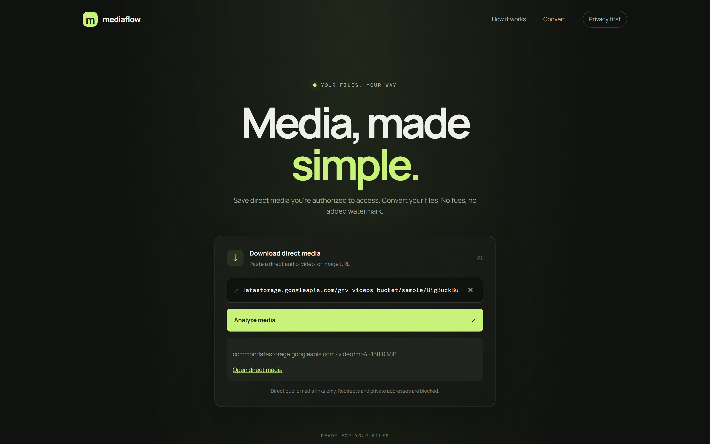
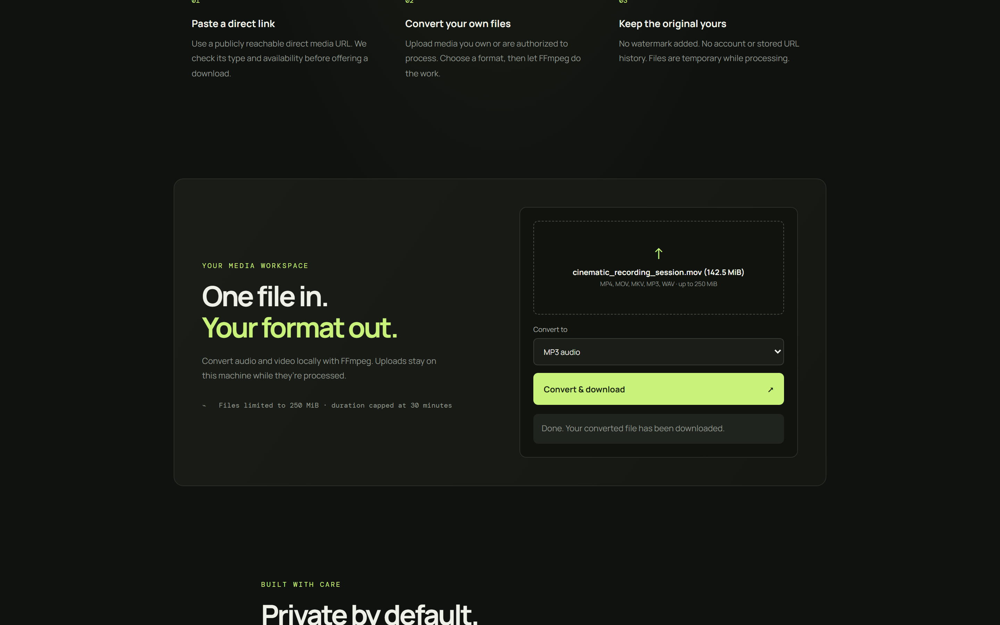
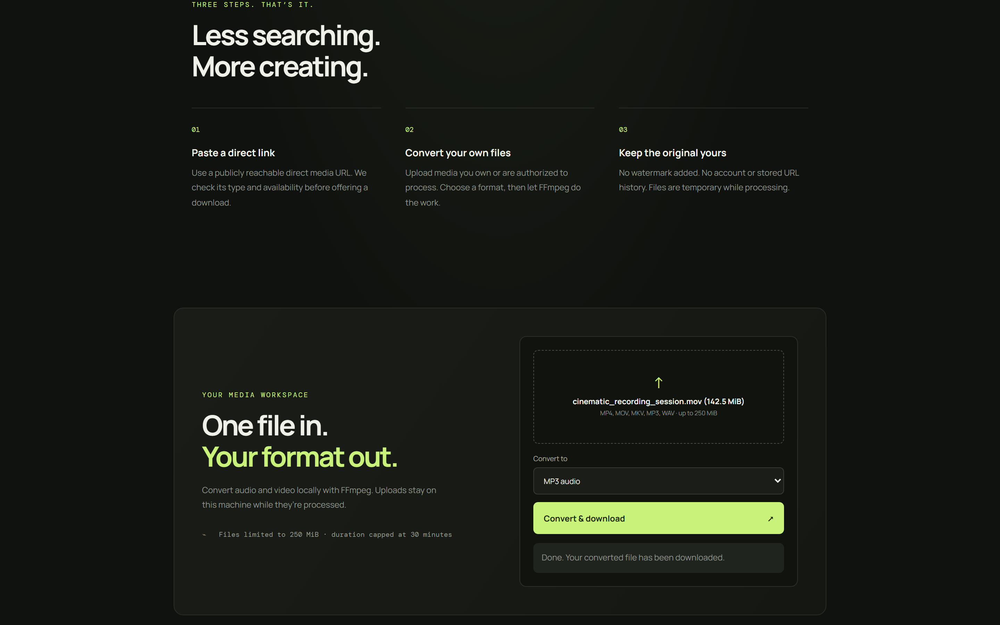
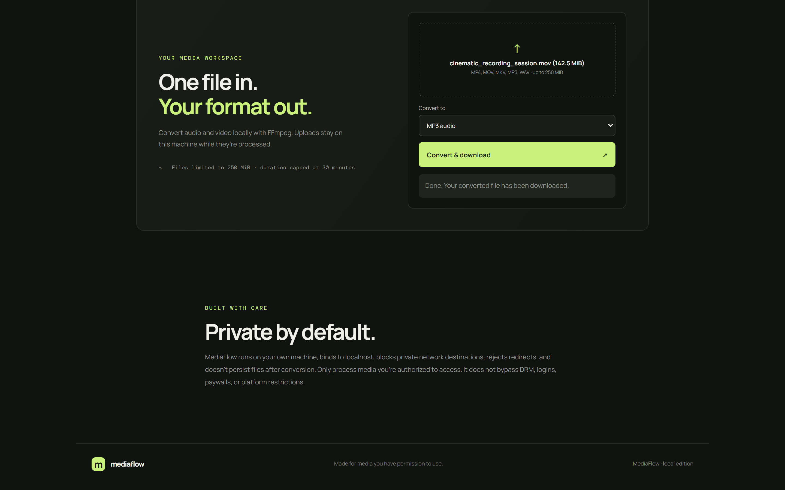

# MediaFlow

Private-use downloader and converter for media you own or are authorized to process. This initial release supports **direct public media URLs** and uploaded files only; it does not bypass platform protections or support social-platform extraction.

## Screenshots

### 1. Direct Media Downloader & Inspection
Antarmuka beranda menyajikan panel analisis dan pengunduhan file media langsung (*direct media inspection*), memvalidasi ketersediaan host publik secara aman, mengekstrak tipe konten MIME (`video/mp4`) dan ukuran file (158,0 MiB) tanpa menebak metadata, memblokir pengalihan alamat dan subnet IP lokal secara ketat, serta menyediakan tautan unduh langsung tanpa tanda air (*watermark*).



### 2. Local FFmpeg Media Converter Workspace
Ruang kerja konversi media lokal memfasilitasi pengunggahan file media (hingga batas 250 MiB) dengan pemrosesan langsung menggunakan *argument array* FFmpeg pada mesin lokal pengguna, menyediakan opsi konversi ke format audio dan video populer (MP3, WAV, M4A, OGG, MP4, WebM), serta menampilkan notifikasi penyelesaian konversi secara instan.



### 3. Workflow & Processing Architecture
Panduan alur kerja 3 langkah (*three-step workflow architecture*) memvisualisasikan proses penanganan berkas media dari penempelan tautan publik terverifikasi (*paste direct link*), konversi mandiri berbasis FFmpeg (*convert your own files*), hingga preservasi integritas berkas asli tanpa retensi data jangka panjang (*keep the original yours*).



### 4. Privacy & SSRF Security Defense
Panel tata kelola privasi dan keamanan arsitektur menegaskan prinsip *private by default*, mengikat server hanya pada antarmuka *loopback* (`127.0.0.1`), mencegah celah SSRF dengan memvalidasi resolusi DNS, menolak rentang IP privat RFC-1918, serta membersihkan file sementara (*temporary files cleanup*) secara otomatis begitu proses konversi tuntas.



## Requirements

- Python 3.11+
- FFmpeg and FFprobe on `PATH` for conversion

## Run

```sh
python app.py
```

Open http://127.0.0.1:8000. Bind is loopback-only. Upload limit: 250 MiB. Temporary files are removed at process exit; do not expose this development server to the public internet.

## Features and limitations

- Actual direct-file analysis and streaming download; no guessed metadata or format list.
- Upload conversion to MP3, WAV, M4A, OGG, MP4, or WebM using FFmpeg argument arrays.
- SSRF checks block local/private/reserved IPs, validate DNS, and reject redirects.
- No social-platform adapters yet. Read [PLATFORM_SUPPORT.md](PLATFORM_SUPPORT.md) and [PLATFORM_ONBOARDING.md](PLATFORM_ONBOARDING.md) for official API eligibility, authorization limits, and setup guidance. Login, where supported, must use explicit OAuth consent—not user passwords, cookies, or copied sessions.
- No persistent job queue, rate-limit service, or public deployment configuration yet.

Run checks with `python -m unittest -v`.
